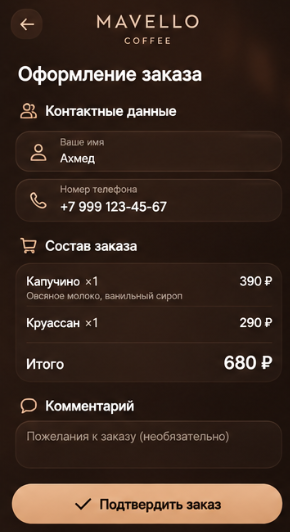
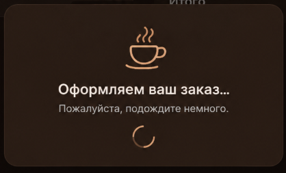

## [C] Контекст

Необходимо сверстать страницу оформления заказа по референсу .

Реализацию делать в отдельной фиче - checkout, если дополнительная фича избыточна - аргументируй до начала работы

Детали реализации этой страницы:

1. В поле имени допускается не более 30-ти символов, при отправке первая буква должна трансформироваться в заглавную, если пользователь написал в нижнем регистре.

2. Для поля номера телефона установить и использовать библиотеку "maska", настроить в нем валидацию по полю из референса.

3. Для списка оформляемых товаров можно использовать уже существующее состояние корзины. Для итоговой суммы - аналогично

4. Поле комментария не должно превышать 200 символов.

5. При нажатии на кнопку "подтвердить заказ" (после первого клика кнопка должна блокироваться для последующего клика) должно произойти два действия:
   5.1. Заказ отправляется пост запросом с телом запроса на бэкенд по соответствующему эндпоинту (http://localhost:3000/orders). Эндпоинт добавить в API_ROUTES. На время обработки реализовать лоадер по референсу .
   5.2. В случае успешной отправки запроса на сервер пользователя редиректит на страницу статуса заказа, которая должна быть сверстана по референсу .

6. При отправке запроса он должен соответствовать контракту из contracts/src/orders.ts.

7. Для формирования idempotencyKey используй встроенный crypto.randomUUID() (UUID v4). Генерируй UUID один раз для каждого нового логического заказа. При повторных попытках отправки одного и того же заказа используй сохранённый pendingSubmission без изменений.

8. В случае ошибки при отправке определяем ее и проводим дальнейшие действия:
   9.1. В случае ошибки с кодом 400 - сначала показываем ошибку пользователю. После исправления данных создаем новый pendingSubmission и UUID, только если сервер гарантирует отсутствие созданного заказа.
   9.2. В случае ошибок 4хх - выдать сообщение о том, что не удалось выполнить заказ с кнопкой для повтора отправки заказа
   9.2. Нет интернета, соединение оборвалось - сохраняем pendingSubmission, разрешаем повтор.
   9.3. Сервер временно недоступен 5хх - сохраняем pendingSubmission, разрешаем повтор.
   9.4. Внутренняя ошибка сервера 500 - сохраняем pendingSubmission, разрешаем повтор с осторожностью, поскольку заказ мог сохраниться на сервере.

9. После успешного ответа сначала сохранить необходимые данные заказа для страницы подтверждения (на данном этапе достаточно сохранение в пинии), затем очистить корзину и pendingSubmission и выполнить переход.

10. Для данного запроса установи таймаут в 10 секунд.

11. Если пользователь изменяет форму или корзину при наличии незавершённой отправки, не допускать незаметной замены сохранённого payload. Предусмотреть явное разрешение этой ситуации.

12. Все сообщения об ошибках должны быть понятны пользователю. Не показывать технические HTTP-коды.

13. Проверить существующие stores, API-клиент, роутинг и соглашения проекта. Переиспользовать готовые решения и не дублировать бизнес-логику.

14. На странице статуса заказа верстка рендерится с данными, которые возвращает бэкенд (ответ приходит очень объемным с бэка, поэтому возвращаемые поля отрегулируй и оставь только те, которые нужны для отображения статуса заказа).

## [О] Результат/Цель - что должно быть

На странице "мои заказы" при клике пользователем на кнопку "оформить заказ" он редиректится на страницу оформления заказа. Пользователь заполняет форму, удостоверяется в полноте заказа, при желании оставляет комментарий и нажимает кнопку "подвердить заказ". После этого появляется загрузка, после которого два сценария:

1. Успешный. Пользователя редиректит на страницу статуса заказа, где он видит сообщение о том, что заказ оформлен и ожидает подтверждения со стороны кофейни.

2. С ошибкой:
   2.1. Если пользователь неправильно заполнил какое то поле, то оно подсвечивается с ошибкой, после исправления которой он может снова подтвердить заказ.
   2.2. Если у пользователя пропал интернет или произошла другая сетевая ошибка, предлагаем также повторно подтвердить заказ.

## [S] Границы

Не трогай бэкенд контракты, а также не меняй БД или в целом бэкенд без моего разрешения, если будет необходимость (например, в изменении возвращаемого ответа от бэкенда) спроси разрешения на операцию

## [T] Проверка - когда готово

1. Проверить отправку запроса.
2. Проверить работу таймаута.
3. Проверить, что в случае сетевой ошибки повторный pendingSubmission не создается, а повторного отправляется с тем же ключом.
4. Все остальные пограничные случаи
5. Проверить сборку на работоспособность
